# Hello, my name is Gabriel Rodrigues Antunes 👋

Spoken Languages

- Brazilian Portuguese
- English

Hobbies

- Coffee and code.
- Geopolitics, music and watching movies.
- Learning about IT and science, understanding how things work internally and how to do them myself.

Social

[![Lattes](https://img.shields.io/badge/Lattes-%2305589c?style=for-the-badge&logo=data%3Aimage%2Fsvg%2Bxml%3Bbase64%2CPHN2ZyB4bWxucz0iaHR0cDovL3d3dy53My5vcmcvMjAwMC9zdmciIHdpZHRoPSI0NSIgaGVpZ2h0PSI0NSIgZmlsbD0ibm9uZSI%2BPGcgY2xpcC1wYXRoPSJ1cmwoI2EpIj48cGF0aCBmaWxsPSIjZmZmIiBmaWxsLXJ1bGU9ImV2ZW5vZGQiIGQ9Ik0yMC4zOTg5IDE4Ljk0MTdjMC0yLjgwMTQgMi4yMi00Ljk2ODYgNC44ODkzLTQuOTY4NiAyLjcyMjEgMCA0Ljg4OTIgMi4xNjcyIDQuODg5MiA0Ljk2ODYgMCAxLjI5NjctLjUxNTEgMi41NDAzLTEuNDMyIDMuNDU3Mi0uOTE2OS45MTY5LTIuMTYwNSAxLjQzMi0zLjQ1NzIgMS40MzJzLTIuNTQwMy0uNTE1MS0zLjQ1NzItMS40MzJjLS45MTY5LS45MTY5LTEuNDMyMS0yLjE2MDUtMS40MzIxLTMuNDU3MlptMjEuNzc3LTguMzUxNGMxLjQzNzcgMy4wMTQ3IDIuMDY2OSA2LjM1MTUgMS44MjYgOS42ODI3LS4yNDA5IDMuMzMxMy0xLjM0MzggNi41NDI4LTMuMjAwMyA5LjMxOTNsNC4wNDM2IDE1LjI0OTFoLTQuODM2NGwtNC43MzA3LTE2LjQxMmMxLjcxNDQtMS44MDk3IDIuOTA5Ni00LjA0NzggMy40Ni02LjQ3OTIuNTUwMy0yLjQzMTMuNDM1NC00Ljk2Ni0uMzMyNi03LjMzNzZzLTIuMTYwNy00LjQ5MjUtNC4wMzE4LTYuMTM5NzNjLTEuODcxMS0xLjY0NzIxLTQuMTUxNC0yLjc1OTktNi42MDEyLTMuMjIxMDktMS45OTEzLS40Mjg5LTQuMDUzOS0uNC02LjAzMjQuMDg0NTItMS45Nzg1LjQ4NDUzLTMuODIxIDEuNDEyMDItNS4zODg4IDIuNzEyNTItMS41Njc3IDEuMzAwNDktMi44MTk2IDIuOTM5OTgtMy42NjEzIDQuNzk0ODgtLjg0MTYgMS44NTQ5LTEuMjUxMSAzLjg3NjctMS4xOTc0IDUuOTEzIDAgMC0yLjk4NjQxIDcuMjk0Mi00LjEyMjgyIDkuOTYzNGgzLjMwMzUydjExLjE3OTJoMTkuOTUzNGwxLjM3NDMgNS4wNDc4SDUuNzA0NzlWMzMuMDU0NEguMTU0ODM5UzYuMjA2OTMgMTkuMjA1OSA2LjE1NDA3IDE4Ljc1NjdDNi41NTA1IDEzLjgxNDYgOC43MTc2MiA3LjgxNTMzIDEzLjM5NTQgNC4xNDE3OSAxNS43MjExIDIuMzE4MjMgMTguODkyNS41NzM5NiAyMy4xNzM5LjE1MTEwN2M0LjU5ODYtLjUwMjEzOSA2LjYwNzEuMzE3MTQgOS42MTk5IDEuNDI3MTMzIDQuMDgwMiAxLjgyMTY2IDcuMzk3OCA1LjAwODQ3IDkuMzgyMSA5LjAxMjA2Wm0tNC45OTUgNC4zODcxYy42OTMyIDIuMjU5OS43NDM5IDQuNjY4LjE0NjUgNi45NTUtLjU5NzQgMi4yODcxLTEuODE5NCA0LjM2MjgtMy41MjkzIDUuOTk0OUwzOC43OTMxIDQ1aC00Ljk5NWMtMS42MTIxLTYuMjg5OS0zLjY3MzUtMTMuMTYxMy01LjMzODUtMTkuMjkyNy45Nzc4LS42MDc4IDMuODMyMS0yLjE2NzEgNC4yMDIxLTUuOTQ2NC40NDkzLTMuNDg4NS0xLjcxNzgtNi4yODk5LTMuMjI0My03LjI2NzgtMS4zMjE0LS44NDU3LTMuMjc3MS0xLjQwMDctNS4xMDA2LTEuMDU3MS0xLjU4ODkuMjEwMi0zLjA2OTkuOTE5OS00LjIyOSAyLjAyNjgtMS4xNTkxIDEuMTA2OC0xLjkzNjQgMi41NTM1LTIuMjE5NSA0LjEzMS0uMDUyOS4zOTY0LS4wNTI5LjU1NS0uMDUyOSAxLjE2MjkgMCAwLTEuNDUzNiAzLjgzMjEtMS44NSA1LjAyMTNoMS4wMDQzdjkuOTM3MWgxMS44Mzk5bDEuNDUzNSA0Ljk0MjFIMTIuMDQ3NlYyNy41NTczbC0yLjUxMDctLjEzMjFjLjk1MTQtMi42NjkzIDMuMzAzNS04LjY2ODUgMy4zMDM1LTguNjY4NS4yMTE1LTIuMTY3Mi4zNy02LjM0MjggNC44MzY0LTkuNzc4NTMgMS45ODIyLTEuNzE3ODQgNS4yNTkzLTIuODgwNjkgOC42Njg1LTIuNTYzNTUgMi40MzYyLjI0MDc4IDQuNzUyMSAxLjE3NTU2IDYuNjcyOCAyLjY5MzM3IDEuOTIwNiAxLjUxNzgxIDMuMzY1NCAzLjU1NDkxIDQuMTYyOCA1Ljg2OTQxWiIgY2xpcC1ydWxlPSJldmVub2RkIi8%2BPC9nPjxkZWZzPjxjbGlwUGF0aCBpZD0iYSI%2BPHBhdGggZmlsbD0iI2ZmZiIgZD0iTTAgMGg0NXY0NUgweiIvPjwvY2xpcFBhdGg%2BPC9kZWZzPjwvc3ZnPg%3D%3D)](http://lattes.cnpq.br/5981427817317311)

Born in Ji-Paraná, Rondônia, Brazil.

Currently living in Ji-Paraná, Rondônia, Brazil.

## Tech Skills

### Operating Systems

### Tools

### Containers

### Clusters

### DevOps & CI/CD

### ECMAScript

### Front-end

### .NET

### PHP

### IDEs & Code Editors

### Data & APIs

### Quality & Design

### Identity & Cloud

---

[Lobby](https://guesant.net/en/) · [Profile Data](https://github.com/guesant/lobby/tree/main/website/src/data) · [Technologies](https://github.com/guesant/resume/blob/main/cv/technologies.yaml)
